# Grover

A small rover built from Makeblock parts, living on a garage workbench and
learning to look after itself. Named Grover on 2026-09-29: blue rails, and it
spends its life demonstrating *near... far*.

This repo is the whole project: a dated [journal](JOURNAL.md) of what
happened and who decided it, the [bill of materials](BOM.md) against a $100
budget, the [roadmap](ROADMAP.md), the off-board brain, printable hardware,
scripts, and a reference copy of the firmware.

It is a collaborative build between Enoch and Claude (Anthropic). The
journal records which model did the work at each stage and which decisions
were Claude-driven versus Enoch-directed. [CLAUDE.md](CLAUDE.md) is the
standing rulebook (mission, hard constraints, budget policy, permissions,
safety rules learned the hard way) - auto-loaded by Claude Code as project
instructions, and readable as plain English by anyone.

## The mission

1. **Phase 1 (done):** drive around the workbench without falling off.
2. **Phase 2 (current):** recharge itself - it docks and charges on the bench; next, on its own when the battery runs low.
3. **Phase 3:** roam the house.

## Where it stands (2026-11-07)

- **It docks and charges by itself.** `dock()` backs Grover off the Eufy
  base, drives the dock's axis on the overhead camera, squares up,
  centres to within 4 mm, climbs a printed ramp onto the base and stops
  the instant the pads touch - **0 mm from the taught pose, charging, on
  film (11-01):** [timelapse](images/52-autonomous-undock-dock-timelapse-2026-11-02.mp4).
  (First done 10-26 on the old board and L298N: [timelapse](images/35-autonomous-dock-timelapse-2026-10-26.mp4).)
- **New spinal cord (11-01):** the ESP32 devkit died when a DRV8871
  header VM pin (12 V) met its 5V; `rover32` is now an **ESP32-S3**
  (YD-ESP32-23) on the same Freenove FNK0101, with a new pin map
  ([wiring](hardware/carrier/spine-deck-wiring.png)). Motor drivers are
  two **DRV8871s** (the L298N is retired); duties 60 % (min/drive/pivot).
- **Carrier rework done (10-31..11-01):** power deck (driver tray, buck,
  Wago buses) on the acrylic, pack in a tray on the tread beams, top
  plate on the posts carrying the FNK0101 and a breadboard, the overhead
  marker on a C-bracket off the rear post bolts.
- **Dock kit:** a white printed approach ramp at the base's tip (the
  lip made every climb lurch), the base painted white for the cliff
  sensors, **dock sense** (pad voltage into GPIO9 - instant contact, and
  the status strip's Charging pulse), **dock mode** (the last few cm
  ignore the cliff guard, forward only, 3 s self-cancelling), and an
  **edge keep-out** in the brain (no move within 130 mm of the open edge).
- **Grover is a tank** (Makeblock tracks since 10-19, after the trike
  went off the bench on 10-18). Pivots scrub, so steering closes on the
  overhead marker pose and the gyro (`turn`), not dead reckoning.
- **Visual homing** (since 10-05): `home_to_marker` parks nose-on to a
  printed marker on the onboard camera; `dock_approach` chained it with
  the overhead `go_to` - far end of the bench to the marker in 66 s
  (10-24), the goal set after Phase 1.
- **It has been through the house** (2026-10-04, as the trike): dining
  room to kitchen doorway, ~12-14 m, in camera-checked legs.
- **Sensors:** TFMini forward LiDAR (obstacle stop 50 cm), two front
  TCRT5000 cliff sensors on wings ahead of the tracks, L3G4200D gyro,
  battery and dock voltage, the onboard camera, the overhead bench camera.
- **The Eufy RoboVac 12** is shelved as a chassis; its charging base is
  Grover's dock.
- Known hazards: rear cliff sensors live since 11-07;
  the cliff guard trips late enough that edge tests need a soft landing
  or a tether. The power-on track twitch should be gone: 10k pull-downs
  on the driver inputs (GPIO38-41) fitted 11-09.

## Architecture

Three layers, decided early and still standing:

| Layer | Hardware | Role |
|---|---|---|
| **Spinal cord** | ESP32-S3 (`rover32`, YD-ESP32-23 since 2026-11-01; an ESP32 devkit 10-03..10-31, a Wemos D1 Mini before), ESPHome | reflexes: watchdog, disconnect-stop, cliff, battery and TFMini obstacle guards, ramped motion, gyro turns, dock sense/dock mode. Authoritative - nothing off-board can override them. |
| **Eyes** | TTGO T-Camera (ESP32-WROVER, OV2640), ESPHome | snapshot and stream endpoints; no decisions |
| **Brain** | `brain/` - Python + OpenCV, off-board | everything with judgment: marker detection, homing, overhead steering, docking. An MCP server (`rover-brain`), run locally and hosted on the cluster. |

Claude (the model) is *not* in the control loop: it starts a run and reads
the log. A run is a plain Python loop - look, decide one pulse, settle,
look again - talking to the rover over ESPHome's native API.

## Hardware

- Chassis: Makeblock kit as a **tank** (two tracks on the tread beams, two
  DC gear motors); power deck on the acrylic plate, spine deck on four
  30 mm posts (terms in `CLAUDE.md`)
- Controller: ESP32-S3 (`rover32`) on a Freenove FNK0101 breakout - pin
  map in [hardware/carrier/README.md](hardware/carrier/README.md), wiring
  in [spine-deck-wiring.png](hardware/carrier/spine-deck-wiring.png)
- Motor drivers: 2x DRV8871 (PWM on IN1/IN2; header VM is 12 V - leave it
  unconnected)
- Power: 3x 18650 in 3S with a BMS (12.6 V full), Wago buses; LM2596 buck at 5.29 V for the ESP32, camera, TFMini and LEDs;
  battery sense 100k/27k into GPIO8 (calibrated); dock sense 100k/15k
  from the pad lead into GPIO9
- Sensing: Benewake TFMini LiDAR (direct GH1.25 lead, 5 V); two front
  TCRT5000 cliff modules at 3.3 V; L3G4200D gyro (yaw = +Z)
- Lights: WS2812B chain on GPIO4 - two headlight dots and a 6-pixel status
  strip (Charging pulse on the dock)
- Vision: TTGO T-Camera on the rover (fisheye, ~111 deg); two Thingino
  cameras on the bench (`benchcam`, the PTZ overhead, and `camv3`)
- Markers: ArUco 4x4_50 - ids 0 (80 mm) and 1 (160 mm) homing targets,
  id 2 (60 mm) on Grover's top for the overhead camera, id 3 (50 mm) on
  the dock tower - pages in `hardware/markers/`, each with a 100 mm scale
  bar; print at 100 %, or send one straight to a network inkjet with
  `scripts/print_marker.py`

## Software

- **Firmware:** ESPHome (`firmware/rover32.yaml` for Grover,
  `firmware/blackcam.yaml` for the Eufy's lid board; `rover.yaml` and
  `eufy-ir.yaml` are retired - all reference copies; the live configs with
  secrets are in a private repo).
  Services `move`, `set_speeds`, `turn`, `stop` and the old
  `forward`/`backward`/`left`/`right`; `Drive duty`, `Pivot duty`, `Min duty`
  (all 60 % on the DRV8871s), `Left trim` (+6 %), accel/decel ramps,
  `Gyro axis`/`Gyro scale`, `Obstacle stop` (50 cm), `Brake on stop` and
  `Dock mode` switches, a `Restart` button.
- **Brain:** `brain/` - MCP tools `status` (incl. dock sense), `snapshot`,
  `locate`, `drive`, `turn`, `face`, `go_to`, `dock`, `dock_approach`,
  `find_marker`, `home_to_marker`, `set_ramp`, `set_brake`,
  `set_obstacle_stop`, `stop`; edge keep-out in `brain/keepout.py`; step
  logs of notable runs in `brain/runs/`. Install with
  `scripts/install-brain.sh`; details in `brain/README.md`.
- **Printing:** parametric OpenSCAD in `hardware/` (camera cradle, adapter
  strip, TFMini bracket, cliff-sensor mounts, caster skid, marker pages, a
  shelved Roomba plug), sliced with the house rules
  (PETG, no brim, tree supports on auto) and printed through the
  print-warden service; toolchain via `scripts/install-tools.sh`.
- **Scripts:** `rover_ctl.py` (drive over the native API),
  `record_bench.py` (overhead timelapse with telemetry burned in),
  `dock_trials.py` (repeatability: undock, random start, dock, logged; attended),
  `test_disconnect_safety.py` (proves the disconnect-stop),
  `camera_snapshot.py`, `warden_call.py` (talk to the print-warden from a
  shell). All read hosts and credentials from environment variables.

### Safety design

A device that can drive off a table needs more than "send stop when you
mean it." In the firmware, always on:

- **Command watchdog** - no drive command for 1.5 s -> motors stop.
- **Disconnect-stop** - the API client goes away for any reason -> motors
  stop. Verified by `scripts/test_disconnect_safety.py`.
- **Cliff guard** - a front IR sensor stops seeing the bench -> forward and
  pivots refused (backward stays allowed). Only exception: `Dock mode`,
  which the brain turns on within 50 mm of the taught docked pose for
  forward motion only, and which switches itself off after 3 s.
- **Rear cliff guard** (since 11-07) - a rear sensor stops seeing the bench
  -> reverse and pivots refused, a backward move stops (forward stays allowed).
- **Battery guard** - below 9.3 V the rover refuses to drive; resumes above
  9.6 V. Rolling 25 s average, ignored for 20 s after boot (a latched-low
  bug from a bad first sample was fixed 2026-10-05).
- **Obstacle guard** - the TFMini (polled every 50 ms) refuses and cuts
  forward motion inside 50 cm; "was under 60 cm, now too close to measure"
  counts as an obstacle (a wall met at an angle slipped through before).
- **Ramped starts** - from rest straight to `Min duty` (both tracks break
  stiction together), then a ramp to the set duty; ramped stops.
- **Brake-on-stop** (switch, boots off) - shorts the windings for 150 ms on
  every stop. Measured: no change in distance and it didn't stop the
  end-of-pulse yaw (the swivel caster did that).

The brain adds courtesy limits on top (pulse cap, gap between pulses,
lost-marker and stuck detection) but never replaces the firmware's.

## The house chassis: a Eufy RoboVac 12

**Shelved as a chassis since 2026-10-24** (intact; its charging base is
now Grover's dock). It was the plan for Phases 2 and 3, keeping its own
docking, charging, cliff and bumper behaviour, driven over infrared. Its remote
sends a 6-byte frame `68 CMD HH MM 5C SUM` - **the current time is stamped
into every command**, and stale frames are ignored. `blackcam`, a T-Camera
on the lid (`firmware/blackcam.yaml`), stamps each frame from SNTP and
drives a 940 nm LED through an NPN transistor (~105 mA, 2 m range). It has
backed the Eufy off its dock and sent it home. See Tier 2E in the roadmap.

## Pictures

### How Grover changed

Each big design change, newest first, with why it happened (the full story
is in [JOURNAL.md](JOURNAL.md)). From the carrier rework on, each change gets
the same three shots - side, top, rear - so the builds compare directly.

| Date | Build | Why it changed | Photo |
|---|---|---|---|
| 11-01 | **ESP32-S3 spinal cord, dock kit**: `rover32` on a YD-ESP32-23 in the same FNK0101 (new pin map); dock sense on GPIO9; a white approach ramp at the dock; the marker on a C-bracket; the left motor re-seated on its gearbox | The ESP32 died to 12 V from a DRV8871 header VM pin; the dock's lip made climbs lurch; the loose motor (from the 10-18 fall) turned pivots into forward arcs | [dock front](images/47-dock-front-edge-ruler-2026-11-01.jpg), [timelapse](images/52-autonomous-undock-dock-timelapse-2026-11-02.mp4) |
| 10-31 | **Carrier rework** (done 11-01): DRV8871 drivers on a printed power deck with Wago buses; pack in a tray on the tread beams behind the deck; a fixed top plate on the posts for the FNK0101 breakout and a breadboard; rear cliff bar | The wiring had become "almost unmanageable" (Enoch); the DRV8871s are smaller than the L298N and drop far less voltage | [before](images/37-electronics-before-rework-2026-10-31.jpg), [top](images/44-battery-tray-and-power-deck-top-2026-10-31.jpg), [rear](images/45-rear-view-battery-tray-motor-2026-10-31.jpg) |
| 10-24..26 | **Docking tank**: pad bars on the nose, bumper bar, LED headlight; docks and charges on the Eufy base by itself | Phase 2, recharging | [docked](images/32-docked-2026-10-24.jpg), [timelapse](images/35-autonomous-dock-timelapse-2026-10-26.mp4) |
| 10-22 | **Tank again**: pack cradle on the deck posts, camera mount on the front perch, gyro | The ramped motion engine removed the reason for the trike; the trike's balance line made cliff stops tip it | [side](images/09-tank-side-2026-10-22.jpg) |
| 09-29..10-18 | **Trike**: two driven wheels + caster, later a fixed skid | Tank pivots skidded (stiction, 100 % bursts); ended when it fell off the bench on 10-18 | [at the edge](images/04-trike-at-the-edge-2026-10-18.jpg) |
| 09-27 | **First tank**, the Makeblock kit as built | First drive | [first drive](images/02-first-drive.jpg) |

### The carrier rework, 2026-10-31

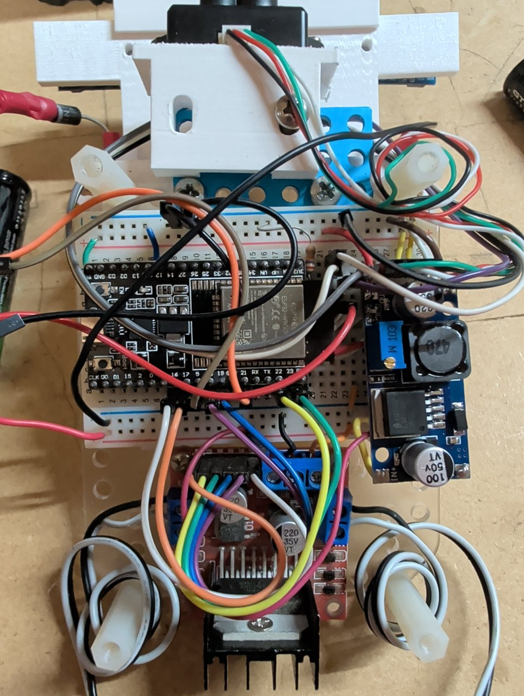
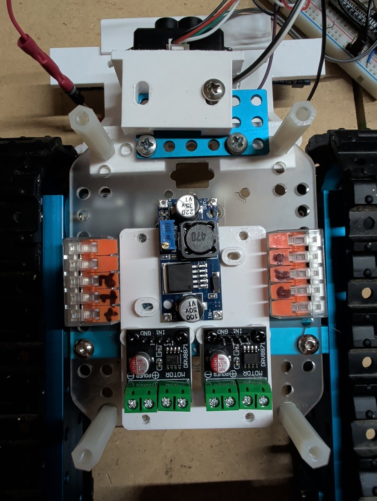
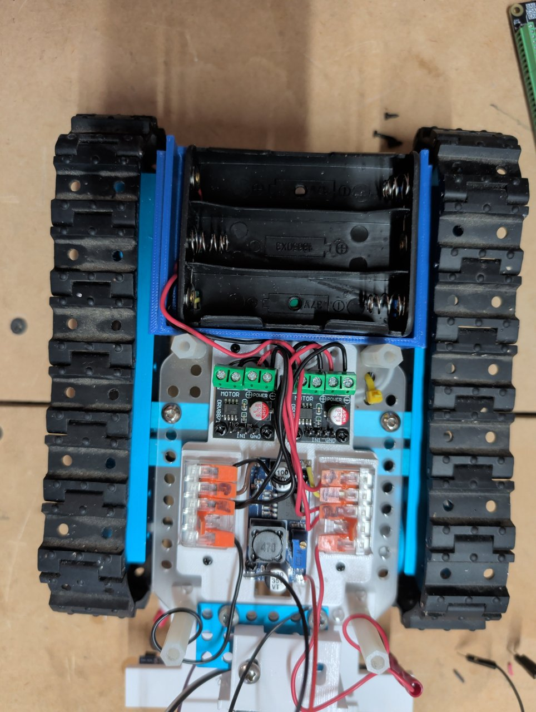
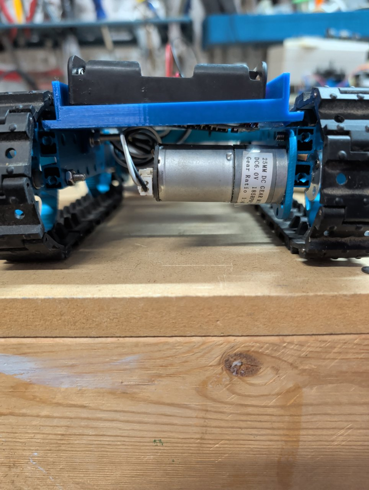

### Docking, 2026-10-24..26

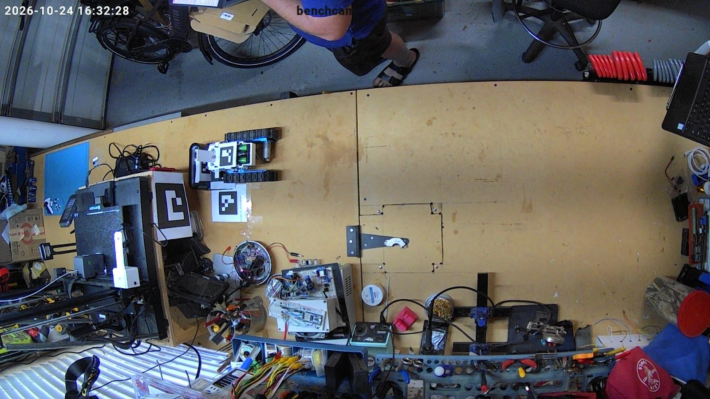

Autonomous undock, dock and charge: [timelapse](images/35-autonomous-dock-timelapse-2026-10-26.mp4).

### The tank, 2026-10-22

Assembled with the pack, cradle and camera, seen assembled with the pack, cradle and camera, seen
from the overhead bench camera; its own view down the bench to the homing
marker; and after its first gyro-closed 90 deg turn.

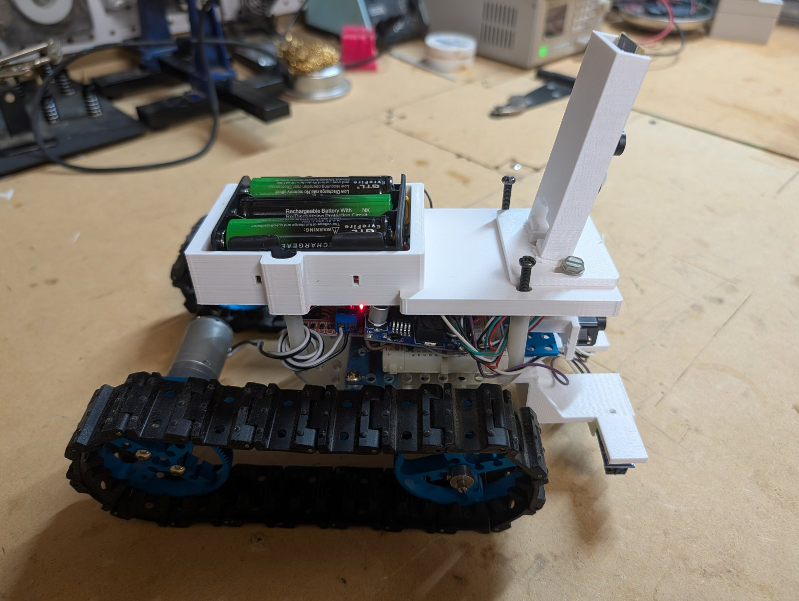
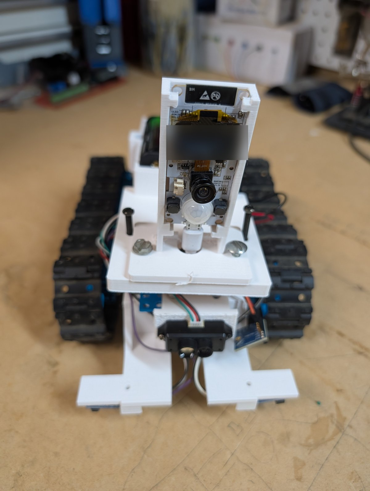
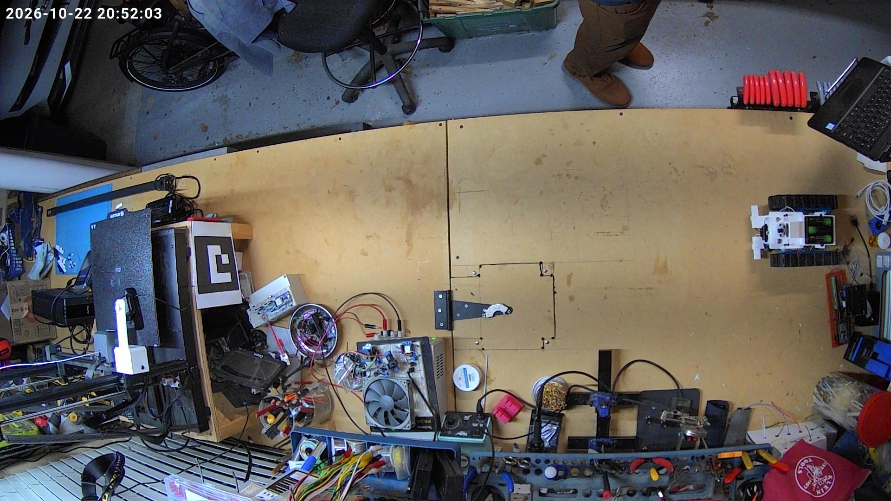
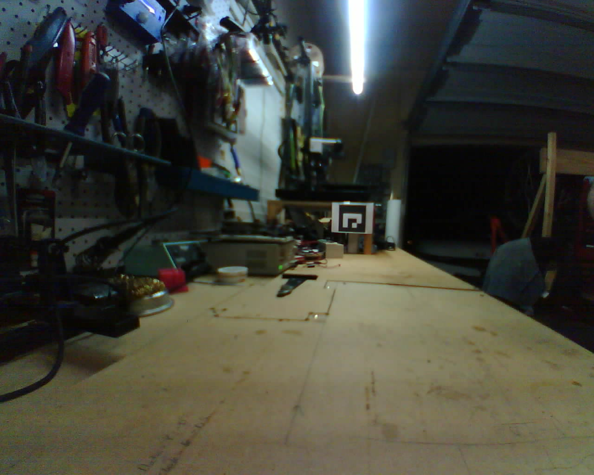
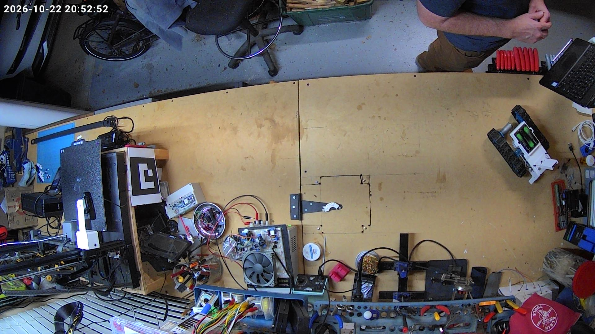

### The trike, 2026-10-18

At the open edge with its skid an hour before
the fall, and the kit being rebuilt as the tank the same evening.

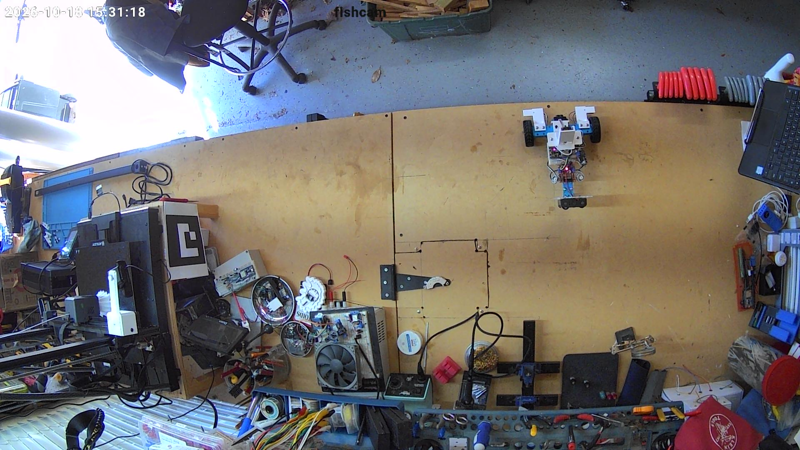
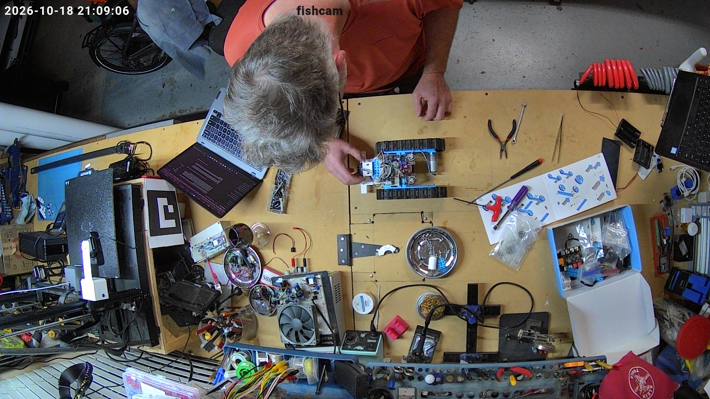

### First drive, 2026-09-27

The original Makeblock tank, before the trike:

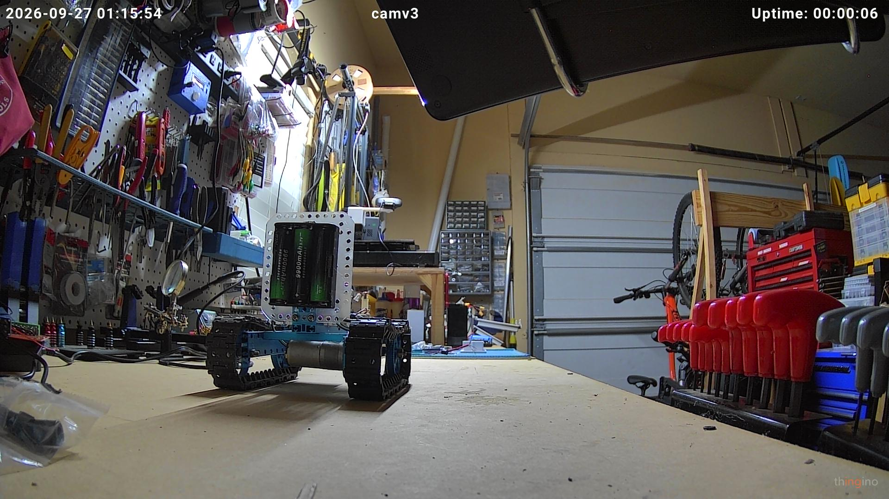
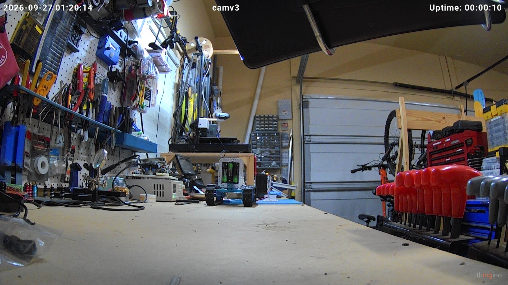
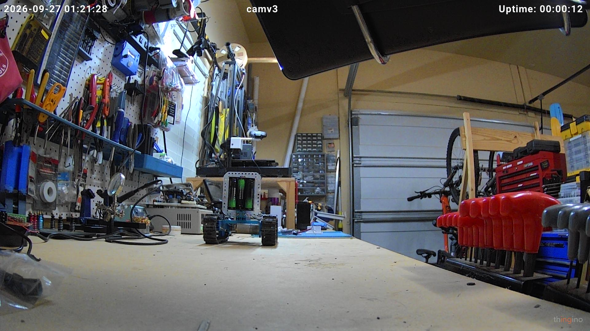

## Budget

Parts already in Enoch's inventory are supplied by him. Anything else comes
out of a standing **$100 budget** tracked in [BOM.md](BOM.md). Spent so far:
$0.00.

---

Built and driven in collaboration with Claude (Anthropic).
